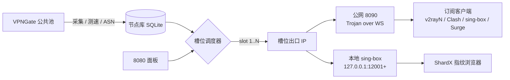
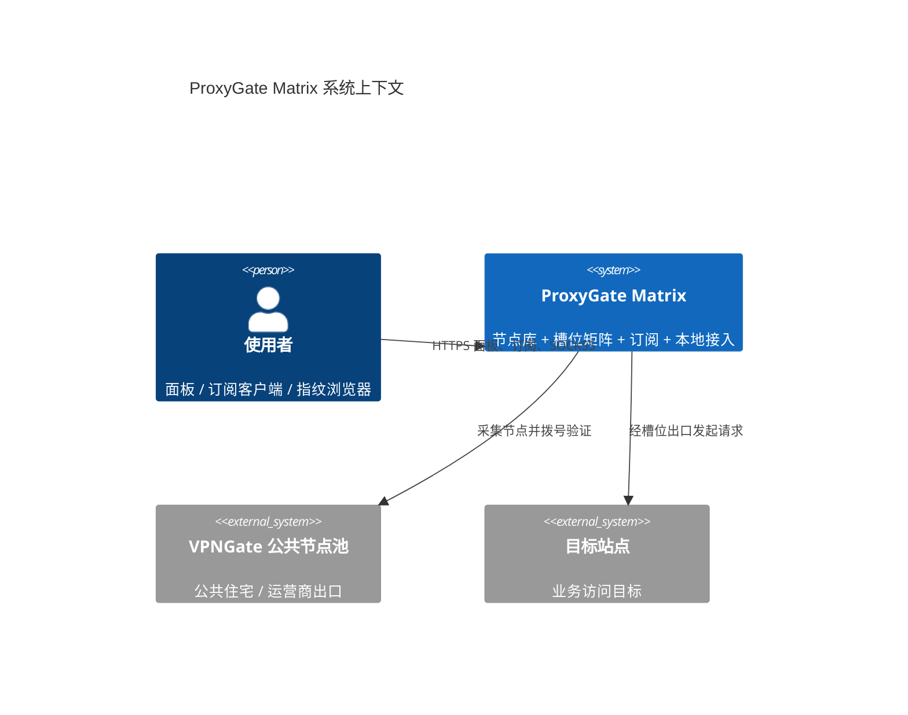
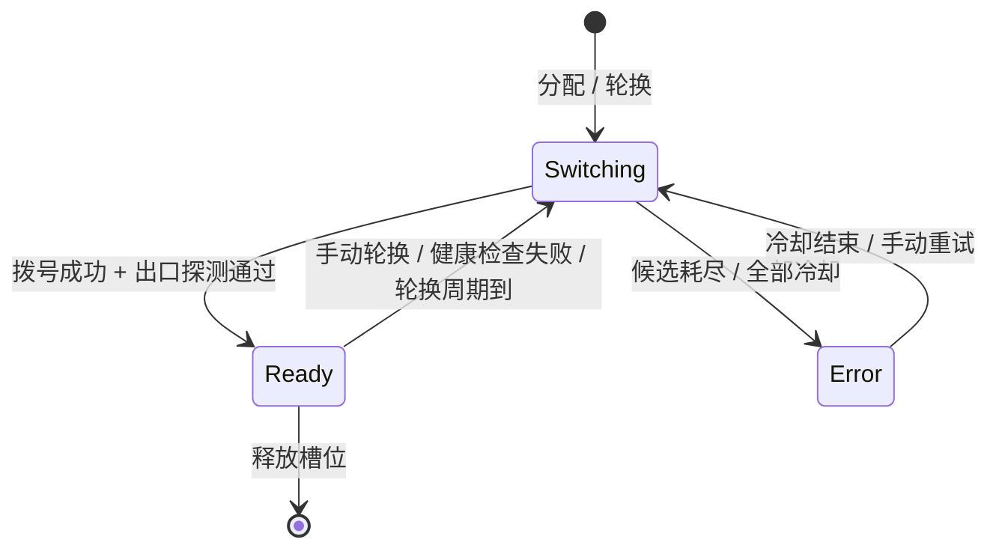
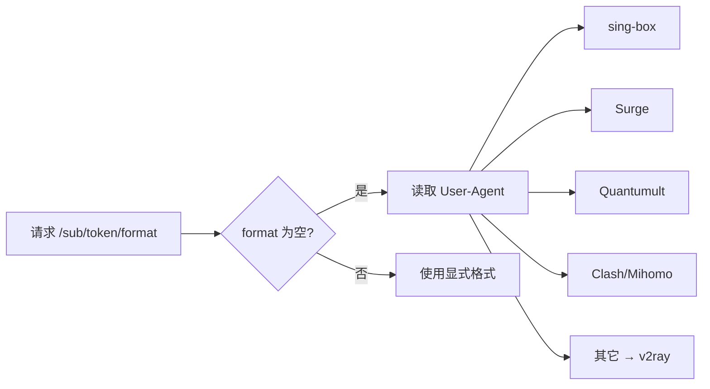
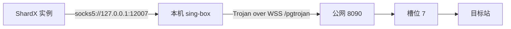

# ProxyGate Matrix

> 把 VPNGate 公共节点池变成可编排的多槽位出口矩阵：一面板管国家，一订阅喂客户端，一本地包喂指纹浏览器。

[](https://go.dev)
[](LICENSE)
[](#docker-部署)

ProxyGate Matrix 是 [ExpTechTW/proxygate](https://github.com/ExpTechTW/proxygate) 的多槽位矩阵分支。它在原来的节点采集与面板之上，增加了「每个槽位固定一个国家、固定一个出口」的调度层，并把结果同时输出成三种形态：

- **订阅**：v2rayN / Clash / sing-box / Surge / Quantumult X，走公网 HTTPS。
- **本地接入包**：sing-box 在本机开一组 SOCKS5 端口，专供 ShardX 等指纹浏览器按实例分配国家。
- **HTTP API**：按 key 分配、轮换、查询槽位，方便接入自己的调度系统。

---

## 链路一览



一句话：**槽位是稳定单位，节点是消耗品**。槽位绑定国家和端口；底层节点掉线时只换节点，不换国家、不换端口。

---

## 功能

| 能力 | 说明 |
| --- | --- |
| 多槽位矩阵 | 每个槽位独立国家、独立 SOCKS5 端口、独立出口 IP |
| 严格国家过滤 | `countries=JP,KR` 只返回这两个国家，绝不回退到其它国家 |
| 质量调度 | 成功次数、失败次数、延迟、带宽、ASN 类型共同决定排序 |
| 拨号闸门 | 每秒令牌、每端口每分钟目标数、全局每小时目标数、失败冷却 |
| 分享上限 | 一份配置控制订阅、分享页、本地接入包暴露的节点数 |
| 订阅多格式 | v2ray / Clash / sing-box / Surge / QX / SOCKS / CSV |
| 本地接入 | 面板一键下载 sing-box 配置或完整 zip，端口 = 起始端口 + 槽位号 - 1 |
| 前置代理 | 池子拨号可走 slot / api / socks5 / http / list，避免本机 IP 直接扫段 |
| 面板管理 | 槽位、国家、质量、速度、协议筛选，批量分配与轮换 |

---

## 快速开始

### Docker 部署

```bash
git clone https://github.com/wbi35772/proxygate-matrix.git
cd proxygate-matrix
cp .env.example .env
```

至少填三项：

```dotenv
PROXYGATE_API_KEY=一串足够长的随机值
PROXYGATE_MATRIX_PASSWORD=槽位 SOCKS5 密码
PROXYGATE_MATRIX_PUBLIC_HOST=你的公网域名或 IP
```

启动：

```bash
docker compose up -d --build
docker compose logs -f
```

首次启动会在 `/data/config.json` 生成管理员账号与随机密码，日志里会打印一次，登录后请立即修改。

| 端口 | 用途 |
| --- | --- |
| `8080` | 管理面板 |
| `8090` | 订阅入口、Trojan over WS、健康检查 |
| `10801-10900` | 槽位 SOCKS5（仅容器/内网；公网需自行映射或改用本地接入包） |
| `12001+` | 本地接入包在**你自己机器**上监听的 SOCKS5，不在服务器上 |

### 二进制部署

```bash
make web     # 构建前端到 web/dist
make build   # 产出 build/dist/proxygate
./build/dist/proxygate -config ./config.json
```

`config.json` 不存在时会自动生成，包含面板账号、API key、订阅 token 和矩阵默认值。

---

## 架构速览



槽位生命周期：



---

## 核心概念

| 概念 | 含义 |
| --- | --- |
| 槽位 Slot | 一个固定编号的出口单元，绑定国家、端口、Trojan 密码 |
| 候选 Candidate | 节点库里满足国家、协议、端口、冷却条件的节点 |
| 质量分 | 由成功率、延迟、带宽、ASN 类型计算的综合分，默认 50 |
| 拨号闸门 | 限制拨号速率与目标重复度，避免看起来像端口扫描 |
| 前置代理 | 访问节点池时使用的上游代理，支持槽位复用或外部 API |
| `ModeSticky` | 槽位保持同一个出口，除非失败或手动轮换 |
| `ModeRotating` | 到 `rotateInterval` 自动换节点，默认 5 分钟 |

细节见 [架构文档](docs/architecture.md) 与 [运维手册](docs/operations.md)。

---

## 面板

- **节点页**：国家、质量、速度、协议筛选；单节点勾选；批量分配国家；批量轮换。
- **分享页**：`01 节点` / `02 订阅链接` / `03 本地接入` / `04 使用说明` 四个标签。
- **设置页**：槽位数、起始端口、分享上限、拨号间隔、前置代理、订阅客户端。

> 修改槽位总数需要重建容器（环境变量 `PROXYGATE_MATRIX_SLOTS`）；分享上限、拨号间隔、国家分配都即时生效。

---

## 订阅

```
https://你的域名/sub/<token>/<format>
```

`format` 可省略，服务端按 User-Agent 自动判断：



最常用的几个：

| 地址 | 用途 |
| --- | --- |
| `/sub/<token>/v2ray` | v2rayN、Xray、Shadowrocket |
| `/sub/<token>/clash` | Clash Verge、Mihomo、Stash |
| `/sub/<token>/singbox` | sing-box 客户端 |
| `/sub/<token>/socks` | SOCKS5 列表（需要公网 SOCKS 入口） |
| `/sub/<token>/sockscsv` | CSV，交给脚本或指纹浏览器导入 |

筛选示例：

```
/sub/<token>/v2ray?countries=JP,KR&preset=quality&count=12&shuffle=true
/sub/<token>/clash?slots=3,7,11-15&group=none
```

完整参数见 [订阅文档](docs/subscriptions.md)。

---

## 本地接入（ShardX）

公网裸 TCP 通常不可得，所以本地接入改成「本机 sing-box 入站 + 公网 Trojan 出站」：



- 端口规则：`port = basePort + slotId - 1`，槽位掉线只留空档，不会串国家。
- 面板 → 分享页 → 本地接入，选择起始端口，下载 zip。
- 解压后放好 `sing-box.exe`，双击 `start.cmd`，把 `shardx.txt` 粘进 ShardX。

步骤与排障见 [本地接入文档](docs/local-access.md)。

---

## API

面板会话接口用 Cookie，程序接口用 API key：

```bash
curl -H "Authorization: Bearer $PROXYGATE_API_KEY" \
  https://your-host:8080/api/v1/pool/slots
```

```bash
curl -X POST https://your-host:8080/api/v1/pool/allocate \
  -H "Authorization: Bearer $PROXYGATE_API_KEY" \
  -H "Content-Type: application/json" \
  -d '{"country":"JP","mode":"sticky"}'
```

完整端点、字段和错误码见 [API 文档](docs/api.md)。

---

## 容量建议

以 32 槽位、每小时 150 次拨号预算的实测为参考：

| 项目 | 建议 | 说明 |
| --- | --- | --- |
| 槽位 | 24–40 | 超过 40 把 `globalIpPerHour` 提到 200 |
| 分享上限 | 12–20 | 按指纹实例数定，最多 2 个实例共用一个出口 |
| 拨号间隔 | 1200–2500 ms | 槽位越多越要打散节奏 |
| 每小时拨号 | < 120 | 贴近上限就像在扫段 |

端口数量本身不是风险；拨号频率和同一出口上的并发才是。详见 [运维手册](docs/operations.md)。

---

## 文档

| 文档 | 内容 |
| --- | --- |
| [docs/README.md](docs/README.md) | 文档地图与阅读顺序 |
| [docs/architecture.md](docs/architecture.md) | 组件、数据流、状态机、数据库 |
| [docs/deployment.md](docs/deployment.md) | Docker、环境变量、端口、扩容 |
| [docs/api.md](docs/api.md) | 全部 HTTP 接口与示例 |
| [docs/subscriptions.md](docs/subscriptions.md) | 订阅格式、参数、客户端预设 |
| [docs/local-access.md](docs/local-access.md) | sing-box 本地接入与 ShardX |
| [docs/operations.md](docs/operations.md) | 拨号闸门、监控、容量、风控 |
| [docs/troubleshooting.md](docs/troubleshooting.md) | 症状决策树与诊断命令 |
| [docs/development.md](docs/development.md) | 目录、构建、扩展格式 |
| [docs/atlas.html](docs/atlas.html) | 单文件图谱页：mermaid / Chart.js / D3 |

---

## 开发

```bash
go build ./...                 # 后端
cd web/src && npm ci && npm run build   # 前端
make lint                      # 前端 lint
```

前端构建产物在 `web/dist`，后端通过 `embed` 提供面板静态文件。发布流程见 [开发文档](docs/development.md)。

---

## 许可证

AGPL-3.0，与上游一致。上游项目：[ExpTechTW/proxygate](https://github.com/ExpTechTW/proxygate)。

本项目只做技术研究：节点来自公共 VPNGate 列表，请遵守所在地法律与目标站点的服务条款。
