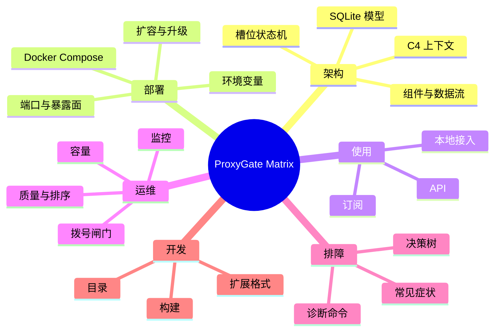
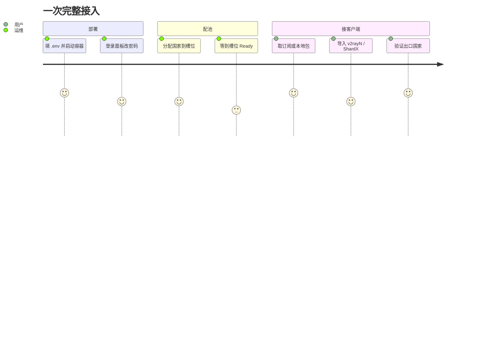

# ProxyGate Matrix 文档

## 从零到可用

## 阅读顺序

| 你是 | 先看 | 再看 |
| --- | --- | --- |
| 第一次部署 | [deployment.md](deployment.md) | [troubleshooting.md](troubleshooting.md) |
| 想理解内部 | [architecture.md](architecture.md) | [operations.md](operations.md) |
| 接客户端 | [subscriptions.md](subscriptions.md) | [local-access.md](local-access.md) |
| 写自动化 | [api.md](api.md) | [operations.md](operations.md) |
| 改代码 | [development.md](development.md) | [architecture.md](architecture.md) |

## 文档清单

| 文档 | 关键词 |
| --- | --- |
| [architecture.md](architecture.md) | C4、容器、时序、类图、ER、Trojan 帧 |
| [deployment.md](deployment.md) | compose、环境变量、端口、需求、扩容甘特 |
| [api.md](api.md) | 认证、端点、curl、错误码 |
| [subscriptions.md](subscriptions.md) | 格式、UA 检测、参数、预设、响应头 |
| [local-access.md](local-access.md) | sing-box、端口映射、ShardX、bundle |
| [operations.md](operations.md) | 拨号预算、质量、监控、容量、轮换 |
| [troubleshooting.md](troubleshooting.md) | 决策树、症状表、日志 |
| [development.md](development.md) | 目录、构建、发布、扩展格式 |

## 约定

- 国家代码统一使用两位大写 ISO 3166-1 alpha-2。
- 时间使用服务器本地时区；配置里的间隔用 Go duration（`15s`、`6h`）。
- 端口只写 TCP，除非明确标了 UDP。
- 文中「实测」均指 2026-11 的 32 槽位部署，数据会随池子波动。
