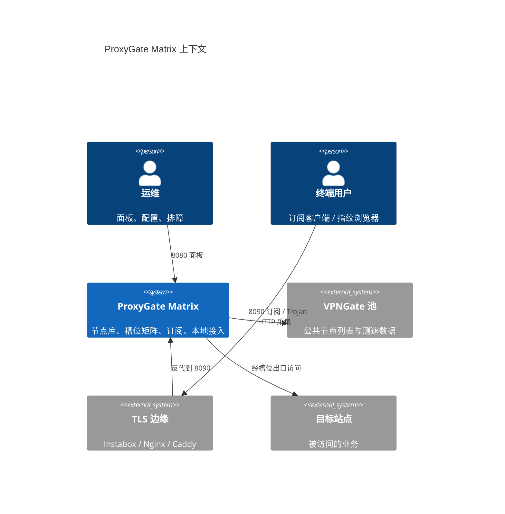
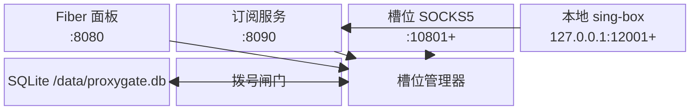
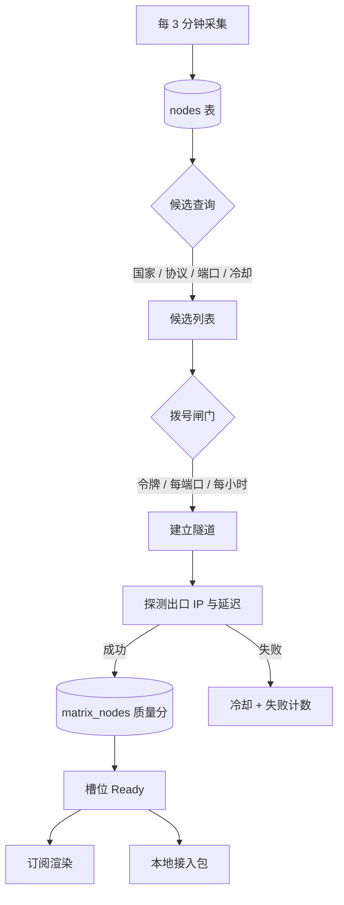
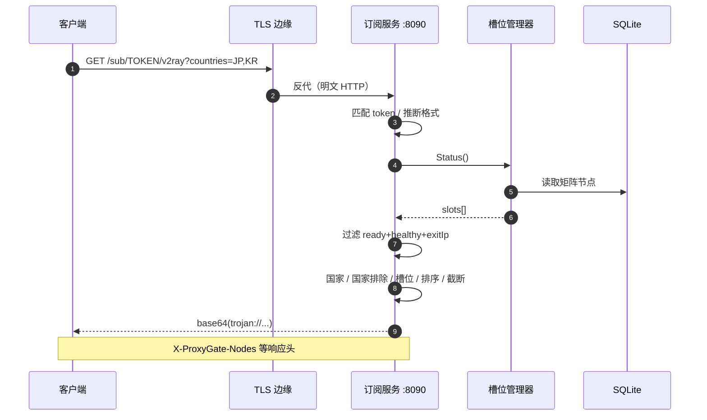
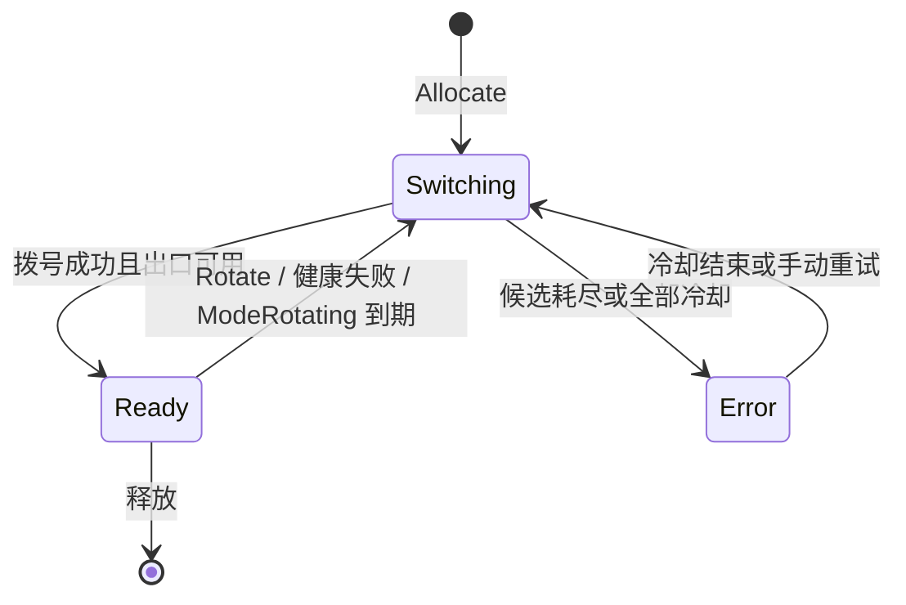
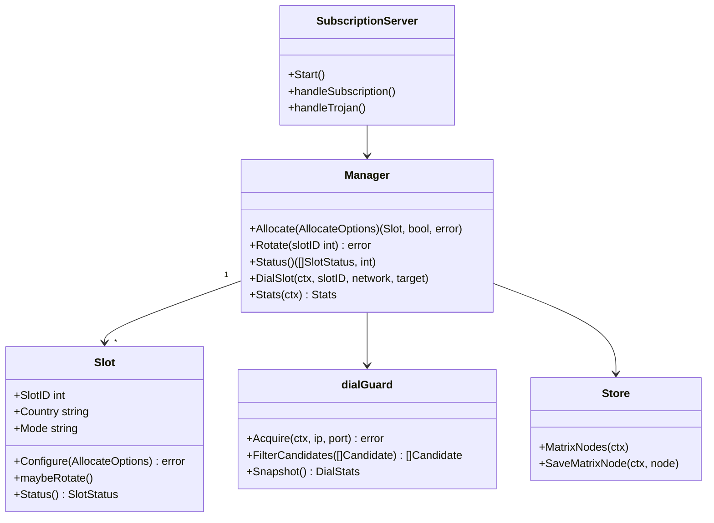
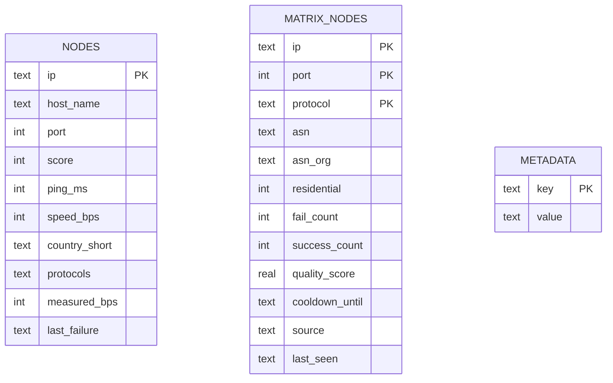
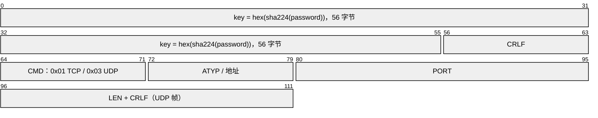
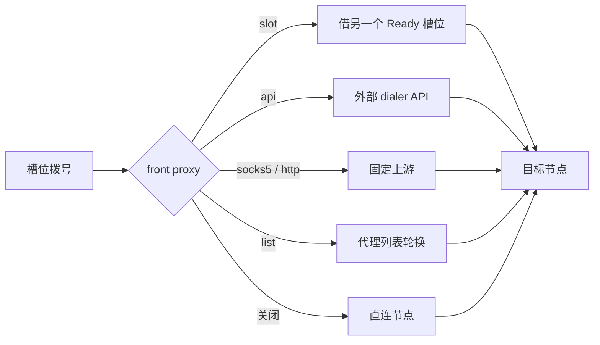

# 架构

这份文档回答三个问题：进程里有什么、一次请求怎么走、槽位为什么会换节点。

## 系统上下文

## 进程与端口

一个二进制里跑着三套监听：Fiber 面板、订阅 HTTP 服务、每个槽位一个 SOCKS5 监听。

| 组件 | 代码 | 职责 |
| --- | --- | --- |
| 面板 | `internal/server` + `web/` | 登录、槽位、配置、分享页 |
| 槽位管理器 | `internal/matrix` | 分配、候选、拨号、轮换、健康 |
| 节点采集 | `internal/vpngate` | 拉列表、测速、ASN、分类 |
| 订阅服务 | `internal/subscription` | `/sub/*`、Trojan over WS、VLESS 兼容 |
| 存储 | `internal/store` | SQLite WAL，节点与矩阵元数据 |
| 前置代理 | `internal/frontproxy` | 拨号链路：slot / api / socks5 / http |

## 数据流

## 一次订阅请求

## 槽位状态机

- `ModeSticky`：默认，保持同一出口，只有失败或手动轮换才换。
- `ModeRotating`：`rotateInterval` 到期后换节点；默认 5 分钟，只在轮换模式生效。
- `Ready` 之外的状态不会进入订阅与本地接入包。

## 核心类型

## 数据库

`matrix_nodes` 在 `nodes` 之上补了 ASN、住宅标记、质量分、成功/失败计数与冷却时间；主键是 `(ip, port, protocol)`，所以同一 IP 的不同协议可以分别评分。

## Trojan over WebSocket

订阅下发的是 `trojan://` 链接，不是 VLESS。原因是 Trojan 的 UDP 帧简单，mihomo、sing-box、Xray 都支持；VLESS 的 mux/XUDP 在网关侧没有实现。

TCP 走 `DialSlot(ctx, slotID, "tcp", target)`；UDP 由槽位开一个非连接套接字，按帧里的目标地址转发，域名在隧道内解析并按会话缓存。

## 出站链路

超时默认 `15s`，可在面板「设置 → 系统 → 前置代理」或 `PUT /api/matrix/front-proxy` 修改。

## 启动顺序

1. 读取 `config.json`，应用环境变量覆盖，校验并持久化。
2. 打开 SQLite，执行迁移。
3. 启动面板 :8080。
4. 启动订阅服务 :8090。
5. 恢复持久化槽位（每个间隔 `startStaggerMs`，默认 3 秒）。
6. `AUTOSTART=false` 时不会新建槽位，只恢复已有的；新增槽位需要显式分配。
