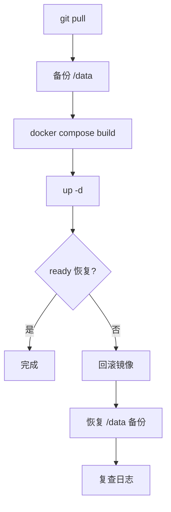

# 部署

## 需求

```mermaid
requirementDiagram
    requirement host {
      id: 1
      text: Linux x86_64 或 arm64，1 vCPU / 512 MB 起
      risk: medium
      verifymethod: test
    }
    requirement docker {
      id: 2
      text: Docker 24+ 与 compose 插件
      risk: low
      verifymethod: inspection
    }
    requirement network {
      id: 3
      text: 8080 与 8090 可达；槽位端口按需
      risk: high
      verifymethod: test
    }
    requirement tls {
      id: 4
      text: 公网域名 + TLS 终止，订阅地址必须是 https
      risk: high
      verifymethod: demonstration
    }
    element server {
      type: VM
    }
    element edge {
      type: reverse-proxy
    }
    server - satisfies -> host
    server - satisfies -> docker
    edge - satisfies -> network
    edge - satisfies -> tls
```

## 拓扑


> 如果 Mermaid 版本较旧不支持 `architecture-beta`，把上面这块当成文字拓扑：客户端 → TLS 边缘 → 8090；面板 8080；槽位 10801+；数据在 /data。

## Docker Compose

```bash
cp .env.example .env
```

```dotenv
PROXYGATE_API_KEY=至少 32 位随机串
PROXYGATE_MATRIX_PASSWORD=槽位 SOCKS5 密码
PROXYGATE_MATRIX_PUBLIC_HOST=proxy.example.com
```

```bash
docker compose up -d --build
docker compose logs -f proxygate
```

首次启动生成 `/data/config.json`，日志会打印一次初始管理员密码。登录后立刻改密码。

### 端口

| 端口 | 协议 | 是否必须公网 | 说明 |
| --- | --- | --- | --- |
| 8080 | TCP | 建议限制来源 | 面板与 API |
| 8090 | TCP | 是 | 订阅、Trojan over WS、`/healthz`、`/metrics` |
| 10801-10900 | TCP | 否 | 槽位 SOCKS5，仅内网/容器 |
| 10801-10900 | UDP | 否 | 槽位 UDP 转发 |

平台只映射 8080/8090 时，公网 SOCKS 入口不可用，请用订阅或本地接入包。这是设计限制，不是故障。

## 环境变量

环境变量在启动时覆盖 `config.json`，之后以文件为准（除非再次用环境变量启动）。

### 基础

| 变量 | 默认 | 说明 |
| --- | --- | --- |
| `PROXYGATE_WEB_LISTEN_ADDRESS` | `:8080` | 面板监听 |
| `PROXYGATE_DATABASE_PATH` | `proxygate.db` | SQLite 路径，容器内建议 `/data/proxygate.db` |
| `PROXYGATE_API_KEY` | 空 | `/api/v1/*` 的 Bearer key，必填 |

### 矩阵

| 变量 | 默认 | 说明 |
| --- | --- | --- |
| `PROXYGATE_MATRIX_ENABLED` | `false` | 总开关 |
| `PROXYGATE_MATRIX_SLOTS` | `35` | 槽位上限，1–256；改动需重建容器 |
| `PROXYGATE_MATRIX_PORT_START` | `10801` | 槽位端口起点 |
| `PROXYGATE_MATRIX_LISTEN_ADDRESS` | `0.0.0.0` | 槽位监听地址 |
| `PROXYGATE_MATRIX_PUBLIC_HOST` | 空 | 订阅与本地接入使用的公网主机 |
| `PROXYGATE_MATRIX_PUBLIC_SOCKS_HOST` | 空 | 只有存在公网 SOCKS 入口时才填 |
| `PROXYGATE_MATRIX_PASSWORD` | 空 | 槽位 SOCKS5 密码 |
| `PROXYGATE_MATRIX_API_KEY` | 空 | 矩阵专用 key，未设则复用 `PROXYGATE_API_KEY` |
| `PROXYGATE_MATRIX_AUTOSTART` | `false` | 是否自动创建槽位；关闭时只恢复持久化槽位 |
| `PROXYGATE_MATRIX_RESIDENTIAL_ONLY` | `false` | 只接受住宅/运营商节点 |
| `PROXYGATE_MATRIX_HARVEST_INTERVAL` | `3m` | 采集间隔 |
| `PROXYGATE_MATRIX_NODE_TTL` | `6h` | 节点过期时间 |
| `PROXYGATE_MATRIX_ROTATE_INTERVAL` | `5m` | 轮换模式下换节点间隔 |
| `PROXYGATE_MATRIX_START_STAGGER_MS` | `3000` | 槽位启动错峰 |
| `PROXYGATE_MATRIX_SHARE_LIMIT` | `0` | 对外暴露节点上限，0 = 全部 |
| `PROXYGATE_MATRIX_DIAL_MIN_MS` | `900` | 拨号前随机等待下限 |
| `PROXYGATE_MATRIX_DIAL_MAX_MS` | `1500` | 拨号前随机等待上限 |

### 订阅

| 变量 | 默认 | 说明 |
| --- | --- | --- |
| `PROXYGATE_MATRIX_SUB_LISTEN` | `:8090` | 订阅监听 |
| `PROXYGATE_MATRIX_SUB_TOKEN` | 派生 | 主订阅 token，默认取 `sha256(apiKey)` 前 24 位 |
| `PROXYGATE_MATRIX_SUB_PATH` | `/pgws` | VLESS over WS 兼容路径 |
| `PROXYGATE_MATRIX_SUB_TROJAN_PATH` | `/pgtrojan` | Trojan over WS 路径 |

### 前置代理

| 变量 | 说明 |
| --- | --- |
| `PROXYGATE_MATRIX_FRONT_PROXY` | 开关 |
| `PROXYGATE_MATRIX_FRONT_PROXY_TYPE` | `slot` / `api` / `socks5` / `socks5h` / `http` / `https` / `list` |
| `PROXYGATE_MATRIX_FRONT_PROXY_URL` | 上游 URL；`list` 用逗号分隔 |
| `PROXYGATE_MATRIX_FRONT_PROXY_SLOT` | `slot` 模式复用的槽位号 |
| `PROXYGATE_MATRIX_FRONT_PROXY_API` | `api` 模式的 dialer 地址 |
| `PROXYGATE_MATRIX_FRONT_PROXY_TIMEOUT` | 默认 `15s` |

## 反向代理

订阅链接必须使用 `https://`；服务端固定按 `443` 与 TLS 生成链接。

Nginx 示例：

```nginx
server {
    listen 443 ssl http2;
    server_name proxy.example.com;
    ssl_certificate     /etc/letsencrypt/live/proxy.example.com/fullchain.pem;
    ssl_certificate_key /etc/letsencrypt/live/proxy.example.com/privkey.pem;

    location / {
        proxy_pass http://127.0.0.1:8090;
        proxy_http_version 1.1;
        proxy_set_header Upgrade $http_upgrade;
        proxy_set_header Connection "upgrade";
        proxy_set_header Host $host;
        proxy_read_timeout 3600s;
    }
}
```

WebSocket 必须放行 `Upgrade`，否则 Trojan 连接会在握手阶段失败。

## 扩容

```mermaid
gantt
    title 32 → 48 槽位扩容
    dateFormat HH:mm
    axisFormat %H:%M
    section 准备
      估算每小时拨号预算      :a1, 00:00, 5m
      备份 config.json        :a2, after a1, 2m
    section 执行
      改 PROXYGATE_MATRIX_SLOTS :b1, after a2, 2m
      重建容器                :b2, after b1, 90s
      恢复既有槽位            :b3, after b2, 3m
      分配新增国家            :b4, after b3, 5m
    section 观察
      看 Ready 数             :c1, after b4, 15m
      看 dialstats            :c2, after b4, 15m
```



步骤：

1. 改 `PROXYGATE_MATRIX_SLOTS`，重建容器；运行中的槽位不会自动扩容。
2. 容器起来后恢复持久化槽位，每个错峰 `startStaggerMs`。
3. 用面板或 `POST /api/matrix/slots/country` 分配新增槽位。
4. 观察 `ready`、`targetsThisHour`、`blocked`。

## 升级与回滚



```bash
docker run --rm -v proxygate-data:/data -v "$PWD:/backup" alpine \
  tar czf /backup/proxygate-data-$(date +%F).tgz -C /data .
```

回滚时使用上一版镜像 tag，并恢复同一份 `/data`。配置和槽位都在 SQLite 与 `config.json` 里。
