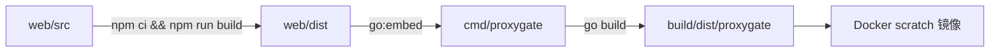
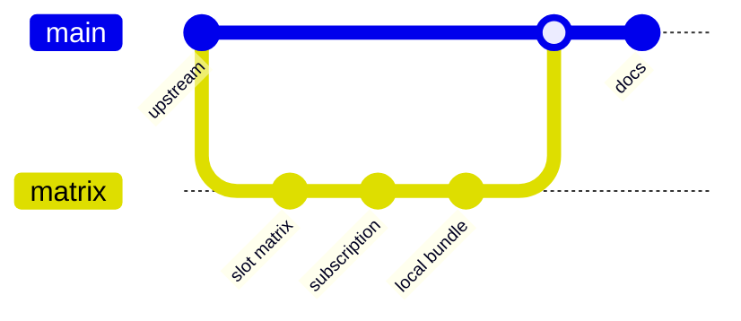
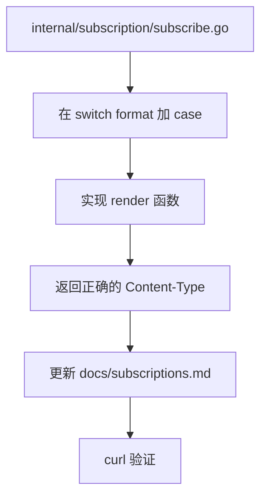

# 开发

## 目录

| 路径 | 内容 |
| --- | --- |
| `cmd/proxygate` | 入口，加载配置、启动 HTTP / 订阅 / SOCKS5 |
| `internal/config` | 配置结构、默认值、校验、环境变量覆盖 |
| `internal/matrix` | 槽位调度、拨号闸门、前置代理、健康检查 |
| `internal/subscription` | 订阅格式、Trojan / VLESS over WS、token 派生 |
| `internal/server` | 面板 API、分享页、本地接入、静态资源 |
| `internal/store` | SQLite（节点库、元数据、矩阵状态） |
| `internal/vpngate` | 公共节点采集、ASN / 住宅标签、测速 |
| `internal/vpn` | 拨号与 DNS |
| `web/src` | React + Vite 面板 |
| `scripts` | 运维脚本（矩阵、槽位、VPS relay） |

## 构建



```bash
# 前端
cd web/src
npm ci
npm run build

# 后端（需要 web/dist 存在）
cd ../..
go build ./...

# 完整构建
make build

# 仅 lint
make lint
```

本地 Go 版本要求 1.26.6；版本写在 `go.mod` 和 `Dockerfile`，升级时两处一起改。

## 发布流程



1. 功能分支开发，保持 `go build ./...` 和 `npm run build` 干净。
2. 更新 `README.md` 与相关 `docs/`。
3. 合并到 `main`，打 tag。
4. 构建镜像并部署，保留上一版 tag 便于回滚。

## 加一种订阅格式



要点：

- 入口在 `handleSubscription` 的 `switch format`。
- 节点结构是 `trojanNode`，不要在里面塞渲染逻辑。
- 新格式要能被 `detectFormat` 命中，或者只允许显式调用。
- 空节点集必须返回可解析的空配置，不要 panic。

## 加一个 API

- 路由集中在 `internal/server/setup.go`。
- 会话接口放在 `api` 分组，API key 接口放在 `pool` 分组。
- 请求体用 `decodeJSON`（`DisallowUnknownFields`），字段名保持 camelCase。
- 错误统一 `writeError`，成功统一 `writeJSON`。
- 改完同步 `docs/api.md`。

## 前端

- React + TypeScript + Vite，文案在 `web/src/src/locales/{zh-CN,zh-TW,en-US}.json`。
- 新增文案三份都要加，缺 key 会直接显示 key。
- 分享页四个标签：`01 节点`、`02 订阅链接`、`03 本地接入`、`04 使用说明`。
- 本地起始端口存在 `localStorage` 的 `proxygate:local-port`。

```bash
cd web/src
npm run dev     # 开发服务器
npm run build   # 产出 web/dist
npm run lint
```

## 配置改动

`internal/config/config.go` 里改结构时，同时处理：

1. `defaults()` 给默认值。
2. `validate()` 给范围。
3. `applyEnv()` 给环境变量（如果需要）。
4. `docs/deployment.md` 的环境变量表。

字符串间隔统一用 Go duration；端口用 int 并校验范围；国家用两位大写代码。

## 测试清单

提交前至少跑：

```bash
go build ./...
go vet ./...
cd web/src && npm run build && npm run lint
```

手工验证：

- [ ] 面板能登录，分享页四个标签都能切。
- [ ] `GET /api/local/plan` 返回端口符合 `basePort + slotId - 1`。
- [ ] 订阅四种格式都能解析（v2ray / clash / singbox / surge）。
- [ ] `countries=JP` 无供给时返回 503，而不是回退其它国家。
- [ ] 容器重启后持久化槽位能恢复。

## 已知限制

- 槽位总数只能在启动时确定，改 `matrix.slots` 要重建容器。
- VLESS 监听保留在 `/pgws` 用于兼容；默认订阅走 Trojan，因为 UDP 和 mux 行为更可控。
- 本地接入的 SOCKS 入站只支持 TCP。
- 节点来源是公共列表，供给会波动，US/SG 等国家无法保证。
