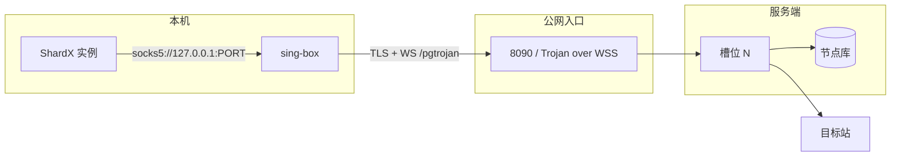
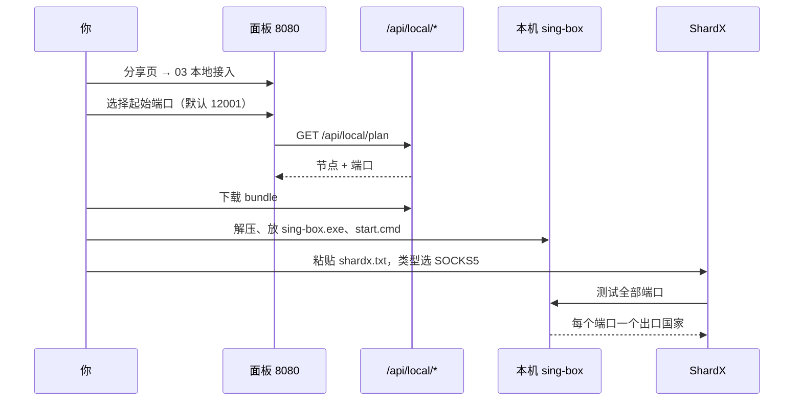

# 本地接入

很多平台（包括 Instabox）只发布 HTTP 端口，不提供公网裸 TCP。槽位 SOCKS5 因此只监听在容器内网，外部指纹浏览器连不上。

本地接入把链路倒过来：**本机开 SOCKS5，公网只走 HTTPS**。



- 入站：`socks`，只监听 `127.0.0.1`，外部扫不到。
- 出站：`trojan`，`server = publicHost:443`，`transport = ws`，路径默认 `/pgtrojan`。
- 每个槽位一个独立入站，路由规则把 `in-NN` 固定指向 `pg-NN-...`。

---

## 端口规则

```
socks5Port = basePort + slotId - 1
```

| basePort | 槽位 1 | 槽位 7 | 槽位 12 | 槽位 32 |
| --- | --- | --- | --- | --- |
| 12001 | 12001 | 12007 | 12012 | 12032 |
| 20000 | 20000 | 20006 | 20011 | 20031 |

槽位掉线时端口留空，**不会**把后面的槽位挪上来。这样 ShardX 里「实例 7 = 韩国」的绑定不会因为一次掉线变成别的国家。

`basePort` 会被夹到 `1024..65000`；小于 1024 的值自动变成 1024。

---

## 四个接口

| 路径 | 内容 |
| --- | --- |
| `GET /api/local/plan?basePort=12001` | JSON 端口计划（不下载文件） |
| `GET /api/local/shardx?basePort=12001` | `shardx.txt`，每行一个 `socks5://127.0.0.1:PORT` |
| `GET /api/local/singbox?basePort=12001` | 可直接 `sing-box run -c` 的配置 |
| `GET /api/local/bundle?basePort=12001` | zip：配置 + 启动/停止脚本 + 说明 |

`plan` 只包含同时满足 `state=ready`、`healthy=true`、`exitIp != ""` 的槽位，并受 `matrix.shareLimit` 截断。

`singbox` / `bundle` 在 `publicHost` 为空时返回 `400`，因为出站地址无从填写。

### plan 响应

```json
{
  "basePort": 12001,
  "host": "sub.example.com",
  "path": "/pgtrojan",
  "missingHost": false,
  "total": 3,
  "nodes": [
    { "slotId": 1, "name": "pg-01-JP-KDDI", "country": "JP", "socks5Port": 12001, "socks5": "socks5://127.0.0.1:12001" },
    { "slotId": 7, "name": "pg-07-KR-KT", "country": "KR", "socks5Port": 12007, "socks5": "socks5://127.0.0.1:12007" },
    { "slotId": 12, "name": "pg-12-TH-AIS", "country": "TH", "socks5Port": 12012, "socks5": "socks5://127.0.0.1:12012" }
  ]
}
```

### 生成的 sing-box 配置

```json
{
  "log": { "level": "warn" },
  "inbounds": [
    { "type": "socks", "tag": "in-01", "listen": "127.0.0.1", "listen_port": 12001 }
  ],
  "outbounds": [
    {
      "type": "trojan",
      "tag": "pg-01-JP-KDDI",
      "server": "sub.example.com",
      "server_port": 443,
      "password": "slot-derived-password",
      "tls": { "enabled": true, "server_name": "sub.example.com" },
      "transport": {
        "type": "ws",
        "path": "/pgtrojan",
        "headers": { "Host": "sub.example.com" }
      }
    },
    { "type": "direct", "tag": "direct" }
  ],
  "route": {
    "rules": [{ "inbound": ["in-01"], "outbound": "pg-01-JP-KDDI" }],
    "final": "direct"
  }
}
```

### bundle 内容

| 文件 | 说明 |
| --- | --- |
| `config.json` | 上面的 sing-box 配置 |
| `shardx.txt` | SOCKS5 列表 |
| `start.cmd` | 检查 `sing-box.exe`，后台启动并打印端口范围 |
| `stop.cmd` | `taskkill /IM sing-box.exe /F` |
| `README.txt` | 中文步骤与端口说明 |

`start.cmd` 不会自动下载 sing-box，只给出下载链接（v1.14.4 Windows amd64）。

---

## 在面板里操作



具体步骤：

1. 面板 → 分享 → `03 本地接入`。
2. 填起始端口（会记在浏览器 `localStorage`）。
3. 下载 zip 或单独下载 `config.json` / `shardx.txt`。
4. 解压到一个固定目录，把 `sing-box.exe` 放进去。
5. 双击 `start.cmd`，窗口最小化即可。
6. ShardX → Proxies → Add proxies → 粘贴 `shardx.txt` → 类型 `SOCKS5` → Test all → Add。
7. 每个实例绑定一个端口；想换国家就改槽位国家，端口不变。

> sing-box 的 socks 入站只支持 TCP。ShardX 检测到 UDP 不通会自动切 TCP-only；需要 UDP 的场景请改用订阅（Trojan UDP 已实现）。

---

## 更新

节点变化后不需要重新配 ShardX：

```bash
# 覆盖 config.json 和 shardx.txt，然后重启
stop.cmd
start.cmd
```

- 端口由槽位号决定，槽位不变端口就不变。
- 密码由 token + 槽位号推导，重新下载配置即可，不需要改客户端。
- 增删槽位后要重新下载；旧配置里不存在的槽位不会自动出现。

---

## 常见问题

| 现象 | 原因 | 处理 |
| --- | --- | --- |
| `missingHost: true` | 没配 `publicHost` | 设置公网域名，或改用环境变量 |
| 端口连不上 | sing-box 没启动 | 看 `start.cmd` 窗口，确认 `sing-box.exe` 在同目录 |
| `sing-box check` 失败 | 配置被截断或手改坏 | 重新下载 bundle |
| 所有端口出口一样 | 槽位都分配到了同一国家/同一节点 | 面板改国家分配，或轮换槽位 |
| 端口空档 | 对应槽位掉线 | 正常行为；等它恢复或手动轮换 |
| ShardX 测试超时 | 本机防火墙拦了 sing-box | 允许 `sing-box.exe` 的本地监听 |

更多见 [排障文档](troubleshooting.md)。
