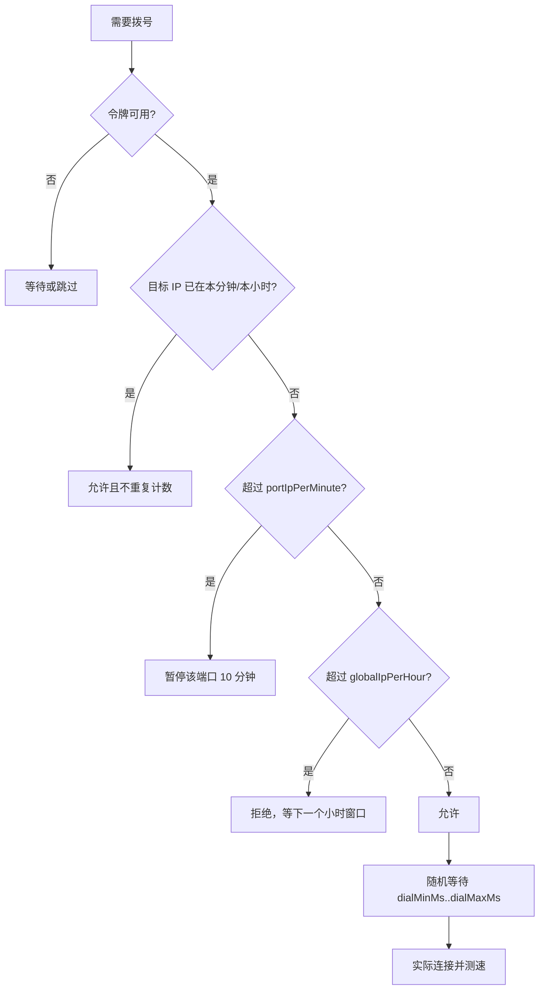
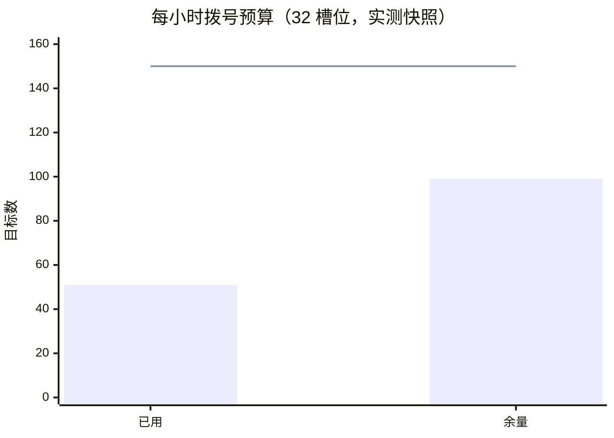
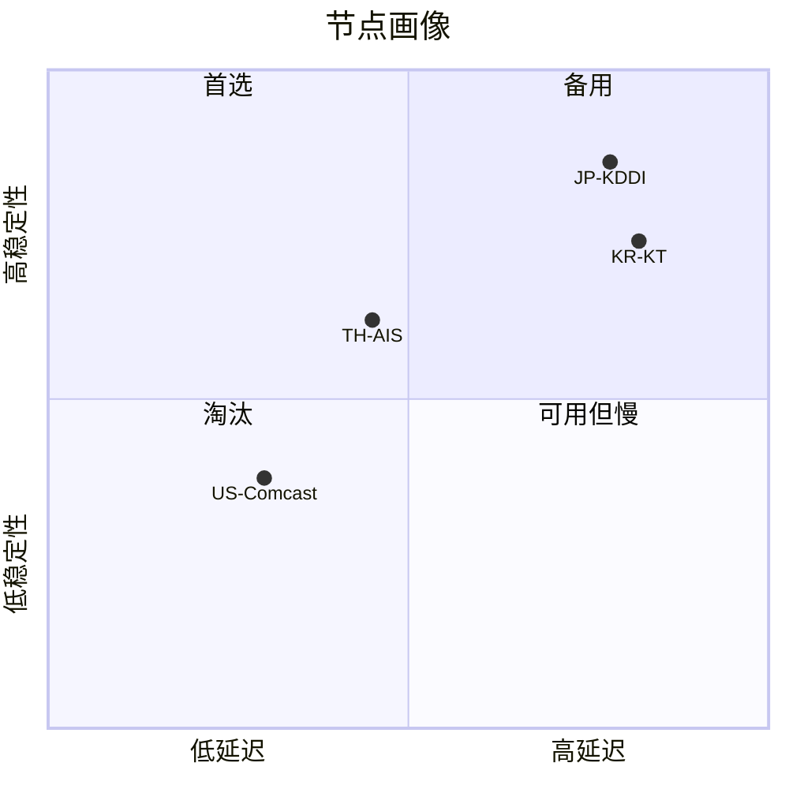
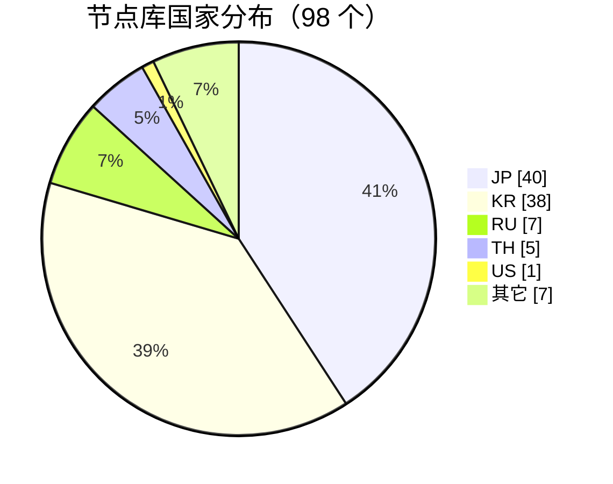

# 运维手册

这份文档回答三个问题：多久拨一次号、怎么判断池子健康、什么时候该扩容。

## 拨号闸门

每一次访问候选节点都要过 `dialGuard.Acquire`。它做四件事：

1. 令牌桶限速：`dialRate` 个/秒，突发 `dialBurst`。
2. 每端口目标去重：同一目的端口一分钟内最多 `portIpPerMinute` 个不同 IP。
3. 全局小时预算：一小时内最多 `globalIpPerHour` 个不同目标 IP。
4. 失败冷却：失败节点在 `failCooldownMinutes` 内不再被选。



| 参数 | 默认 | 作用 | 调整建议 |
| --- | --- | --- | --- |
| `dialRate` | 1 | 每秒令牌 | 保持 1；提高会明显增加扫描特征 |
| `dialBurst` | 3 | 突发容量 | 32 槽位够用，不要超过 5 |
| `portIpPerMinute` | 10 | 单端口每分钟不同目标 | 低供给国家可降到 6 |
| `globalIpPerHour` | 100 | 全局每小时不同目标 | 32 槽位设 150，48 槽位设 200 |
| `failCooldownMinutes` | 360 | 失败节点冷却 | 池子大可以降到 120 |
| `dialMinMs` / `dialMaxMs` | 900 / 1500 | 每次拨号前随机等待 | 槽位多时 1200–2500 |
| `startStaggerMs` | 3000 | 槽位启动错峰 | 保持 3000，别并发起槽 |
| `samePortCandidates` | 2 | 同端口候选上限 | 保持 2–3 |
| `blockedPorts` | 999, 6666, 31337 | 永不拨号的目的端口 | 按需追加 |

### 预算心算

```
一小时可用目标数 ≈ min(globalIpPerHour, 3600 × dialRate)
32 槽位冷启动最小耗时 ≈ 32 × startStaggerMs ≈ 96 秒
```

实际会更慢，因为每次拨号还有 0.9–1.5 秒抖动，失败的槽位还要重试。



`/api/matrix/dialstats` 里 `targetsThisHour` 接近 `globalIpPerHour` 时，新槽位会长时间停在 `switching`，这不是故障。

---

## 质量与排序

质量分不是单一指标，排序时按预设走不同路径：

| 预设 | 排序键 |
| --- | --- |
| `stable` | `failCount` ↑ → `successCount` ↓ → `pingMs` ↑ |
| `quality` | `qualityScore` ↓ → `pingMs` ↑ → `speedBps` ↓ |
| 默认 | 槽位号 ↑ |



- 高稳定 + 低延迟：放 `quality` 预设和 `Auto` 组。
- 高稳定 + 高延迟：适合长连接，不适合抢票类任务。
- 低稳定：即使延迟好看也会被 `stable` 排到后面。

---

## 池子供给

节点来源是公共列表，国家分布极不均匀。2026-11 的实测：



结论：

- JP / KR 可以撑 10+ 槽位。
- TH 能撑 3–5 个。
- US / SG / GB / NL / BR 经常只有 0–1 个，不要给它们固定槽位，否则会反复 `error`。
- `countries=US` 的订阅在供给为 0 时返回 503，这是设计行为，不是 bug。

```mermaid
treemap
    title 槽位国家分配（32 槽位实测）
    "JP" : 11
    "KR" : 6
    "TH" : 5
    "US" : 2
    "FR" : 1
    "IN" : 1
    "空/错误" : 6
```

---

## 监控

| 指标 | 位置 | 健康值 |
| --- | --- | --- |
| 就绪槽位 | `GET /api/matrix/slots` → `ready` | ≥ 期望值的 80% |
| 健康槽位 | 同上 → `healthy` | 接近 `ready` |
| 拨号预算 | `GET /api/matrix/dialstats` → `targetsThisHour` | < 上限的 80% |
| 被拦次数 | `blocked` | 持续增长说明参数太激进 |
| 暂停状态 | `paused` / `pauseReason` | 应为 `false` |
| 订阅可用性 | `GET /sub/TOKEN/v2ray` | 200 且 `X-ProxyGate-Nodes > 0` |
| 服务存活 | `GET :8090/healthz` | `ok` |

```bash
# 一行看关键指标
curl -s -b cookie.txt http://HOST:8080/api/matrix/dialstats \
  | jq '{targetsThisHour, globalIpPerHour, blocked, cooling, paused, dialMinMs, dialMaxMs}'
```

### 冷启动节奏

```mermaid
gantt
    title 32 槽位冷启动
    dateFormat  HH:mm:ss
    axisFormat  %M:%S
    section 恢复持久化槽位
    槽位 1-8   :a1, 00:00:00, 24s
    槽位 9-16  :a2, after a1, 24s
    槽位 17-24 :a3, after a2, 24s
    槽位 25-32 :a4, after a3, 24s
    section 校验
    首次健康检查 :crit, after a1, 15s
    全部稳定     :after a4, 40s
```



容器重启后，持久化槽位会按 3 秒间隔自动恢复；**新增槽位不会自动启动**（`AUTOSTART=false`），需要手动分配或调用 `/api/matrix/slots/country`。

---

## 轮换

```mermaid
timeline
    title 一个槽位的典型一天
    00:00 : 保持出口
    06:00 : 健康检查失败
    06:00 : 自动切换候选
    06:01 : 新出口 ready
    12:00 : 手动轮换（可选）
    18:00 : 出口仍然稳定
```

- `ModeSticky`（默认）：不主动换，失败才换。
- `ModeRotating`：达到 `rotateInterval`（默认 `5m`）换一次。
- 手动：`POST /api/matrix/slots/{id}/rotate`。

不要给业务槽位设很短的轮换周期。指纹浏览器的 cookie、风控画像都绑在出口上，5 分钟一换等于每次都从新 IP 重新开始。

---

## 容量建议

| 槽位 | 每小时预算 | 拨号间隔 | 分享上限 | 适用 |
| --- | --- | --- | --- | --- |
| 8–16 | 100 | 900–1500 ms | 6–10 | 小规模、验证阶段 |
| 24–32 | 150 | 1200–2500 ms | 12–20 | 单机多实例 |
| 40–48 | 200 | 1500–3000 ms | 20–30 | 需要更多国家冗余 |
| > 48 | ≥ 300 | 2000–4000 ms | 按需 | 先确认节点库供给 |

风险不在端口数量，而在：

1. 同一出口 IP 上并发太多指纹实例。
2. 拨号节奏过于规律。
3. 短时间内反复重建槽位。

建议每个出口最多 2 个指纹实例；`shareLimit` 直接按实例数设置，别把所有节点都暴露出去。

---

## 前置代理

如果本机 IP 直接访问节点池不合适，可以给拨号加一层前置代理：

```bash
curl -s -b cookie.txt -X PUT -H 'Content-Type: application/json' \
  -d '{"enabled":true,"type":"slot","slot":1,"timeout":"15s"}' \
  http://HOST:8080/api/matrix/front-proxy
```

| type | 说明 |
| --- | --- |
| `slot` | 用另一个就绪槽位作为出口去拨号 |
| `api` | 调用外部代理 API 获取出口 |
| `socks5` / `socks5h` | 固定 SOCKS5 上游 |
| `http` / `https` | 固定 HTTP 代理 |
| `list` | URL 返回代理列表 |

注意：`slot` 会形成依赖环（槽位 A 通过槽位 B 拨号），至少保留一个不依赖前置代理的槽位。

---

## 恢复 keepalive

`AUTOSTART=false` 是刻意的：容器重启不会立刻拉起全部槽位，避免一次打出几十个拨号。确认以下条件后再考虑打开：

- 连续 1 小时 `ready` 稳定在期望值 80% 以上。
- `blocked` 没有持续增长。
- 平台侧没有新的风控提示。

打开方式：重建容器并把 `PROXYGATE_MATRIX_AUTOSTART` 改为 `true`，其余参数不变。
