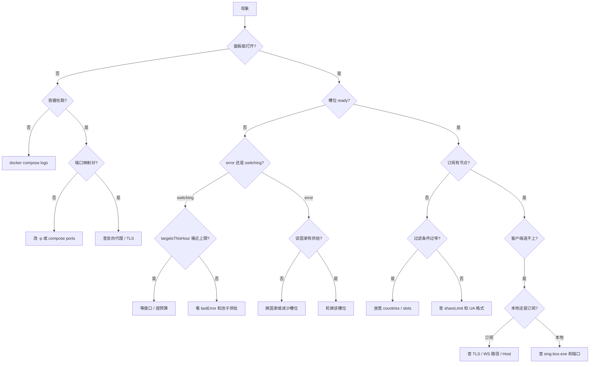

# 排障

先判断问题在哪一层，再动手。



## 症状表

| 现象 | 最可能原因 | 验证 | 处理 |
| --- | --- | --- | --- |
| 面板 502/超时 | 容器没起或端口没映射 | `docker ps`、`curl :8090/healthz` | 看日志、补端口 |
| 登录后立刻 401 | Cookie 没带上 / 会话失效 | `curl -b cookie.txt /api/status` | 重新登录 |
| 所有槽位 `switching` | 拨号预算耗尽或前置代理坏 | `/api/matrix/dialstats` | 等窗口、关前置代理 |
| 某国槽位反复 `error` | 该国家没有可用节点 | `/api/matrix/slots` 的 `countries` | 换 JP/KR/TH |
| 订阅 503 `no ready slots yet` | 池子真的空 | `ready == 0` | 等恢复或手动分配 |
| 订阅 503 `no ready slots match...` | 过滤条件太窄 | 去掉 `countries` 再试 | 放宽过滤 |
| 订阅只有 8 条 | `shareLimit=8` | `GET /api/config` | 改成 0 或更大 |
| Clash 导入报 YAML 错 | 用了错误 format | 看 `Content-Type` | 用 `/clash` |
| v2rayN 导入为空 | 拿到了非 base64 格式 | 看响应头 `X-ProxyGate-Format` | 用 `/v2ray` |
| 本地端口全不通 | sing-box 没启动 | `start.cmd` 窗口 | 放对 `sing-box.exe` |
| 本地端口部分空 | 对应槽位掉线 | `/api/local/plan` | 正常，等恢复 |
| `sing-box check` 失败 | 配置被改坏 | 重新下载 | 覆盖 `config.json` |
| 平台报 `raw TCP ports are not enabled` | 平台不提供公网裸 TCP | 控制台提示 | 用订阅或本地接入 |
| 容器重建后槽位少一半 | 新槽位没分配 | `/api/matrix/slots` | 调 `/slots/country` |

## 诊断命令

```bash
# 容器与服务
docker ps --filter name=proxygate
docker logs --tail 200 proxygate-matrix
curl -s http://HOST:8090/healthz

# 配置（敏感字段已被抹掉）
curl -s -b cookie.txt http://HOST:8080/api/config | jq '.matrix | {slots, shareLimit, dialMinMs, dialMaxMs, publicHost, autostart}'

# 槽位
curl -s -b cookie.txt http://HOST:8080/api/matrix/slots \
  | jq '{ready, healthy, available, by_state: ([.slots[].state] | group_by(.) | map({(.[0]): length}) | add)}'

# 拨号
curl -s -b cookie.txt http://HOST:8080/api/matrix/dialstats \
  | jq '{targetsThisHour, globalIpPerHour, blocked, cooling, paused, pauseReason}'

# 订阅
curl -s -D - -o /dev/null -A 'v2rayN/7.10' \
  'https://HOST/sub/TOKEN/v2ray?count=5' | grep -i 'x-proxygate\|HTTP/'

# 本地接入
curl -s -b cookie.txt 'http://HOST:8080/api/local/plan?basePort=12001' \
  | jq '{total, host, ports: [.nodes[].socks5Port]}'
```

## 逐层排查

### 1. 容器层

```bash
docker compose ps
docker compose logs --tail 100 proxygate
```

常见启动错误：

- `listen subscription on :8090: bind: address already in use`：端口被占。
- `matrix.apiKey is required when the matrix is enabled`：没配 `PROXYGATE_API_KEY`。
- `matrix.password must be ...`：密码为空或含换行。

### 2. 平台层

```bash
curl -s http://127.0.0.1:8080/api/version
```

容器内能通、外部不通 → 平台端口映射或反向代理问题，不是应用问题。

### 3. 矩阵层

```bash
curl -s -b cookie.txt http://HOST:8080/api/matrix/slots \
  | jq '.slots[] | select(.state != "ready") | {slotId, countryShort, state, lastError}'
```

`lastError` 是最直接的线索：

| lastError 关键字 | 含义 |
| --- | --- |
| `no candidates` | 国家/协议/端口过滤后没有节点 |
| `dial timeout` | 节点不可达，换一个 |
| `exit check failed` | 拨通了但出口探测失败 |
| `front proxy` | 前置代理配置有问题 |

### 4. 订阅层

```bash
curl -s -A 'clash-verge/2.0' 'https://HOST/sub/TOKEN/clash' | head -20
```

- 返回 HTML 登录页：TLS 入口配错，`publicHost` 指到了面板。
- 返回 `no ready slots`：矩阵层问题。
- 返回正常 YAML 但节点少：`shareLimit` 或 `count`。

### 5. 本地层

```bash
sing-box check -c config.json
netstat -ano | findstr :12001
```

Windows 上确认 `sing-box.exe` 进程存在、端口在监听、防火墙没有拦截。

## 日志位置

| 日志 | 位置 |
| --- | --- |
| 容器标准输出 | `docker logs proxygate-matrix` |
| 数据库 | `/data/proxygate.db`（volume `proxygate-data`） |
| 前置代理 / 订阅错误 | 同一份容器日志，前缀 `[server]` / `[subscription]` |

## 重置范围

按影响从小到大：


`E` 会丢掉节点库和配置，只在确认数据不要了的时候做：

```bash
docker compose down
docker volume rm proxygate-data
docker compose up -d --build
```
